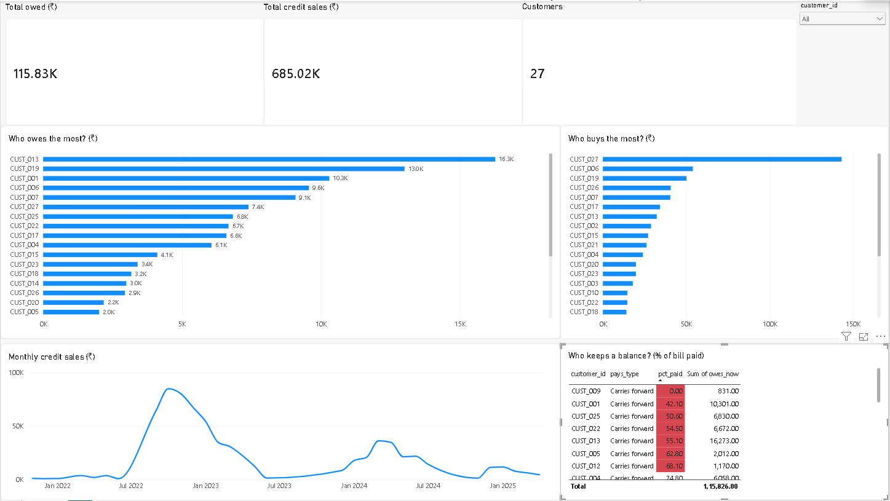

# ShopSense — analysing my father's handwritten credit book

My father runs a small kirana (grocery) store in Bengaluru. Regular customers buy on credit, and he writes every visit in a paper notebook (a *khata*): date + amount. Customers settle up at the start of the next month — some in full, some leaving a balance.

I turned that notebook into data to answer the questions he actually has:

1. **Who isn't paying, and where is our money stuck?**
2. **How much does the shop depend on its biggest customers?** (concentration risk)
3. **Who pays in full and who keeps a balance?**
4. **Who is buying less and may stop coming?** (early warning)
5. **When can we expect money from each customer, and how much?**



## The data

- **3,065 handwritten entries**, **29 customers**, **46 book pages**, Nov 2021 – Apr 2025, transcribed from phone photos.
- Every customer's balance was **reconciled to the totals my father wrote** in the book. Where his total and the lines disagreed (amounts added without a line, round-offs let go when paying), the gap is recorded as an `Adjustment` row, so balances from the data equal his balances.
- Unclear entries (overwritten digits, cut-off photos) are flagged `CHECK:` in the notes — 31 rows — to confirm with him.
- **Privacy:** customers are anonymised as `CUST_001`…`CUST_029`. Real names live only in a private workbook that is not in this repo.

| Column | Meaning |
|---|---|
| `entry_type` | `Purchase`, `Payment`, `Old_Balance` (dues from before the page) or `Adjustment` |
| `amount` | ₹ |
| `written_balance` | the total / *BAKI* (balance) my father wrote, where he wrote one — used as a checkpoint |

## How it's built

```
Phone photos → Excel (enter + verify) → MySQL (store + query) ─┬→ Power BI (dashboard)
                                                               └→ Python (prediction + automation)
```

| Tool | What I used it for |
|---|---|
| **Excel** | Data entry and reconciliation; PivotTable (% of grand total), SUMIFS / COUNTIFS customer summary, XLOOKUP, conditional formatting, data-quality checks |
| **MySQL** | Single source of truth; balances with `CASE WHEN`, `JOIN`s, CTEs, window functions (`RANK`, `LAG`, `SUM() OVER()`), a `customer_summary` view for Power BI |
| **Power BI** | Live dashboard on MySQL: KPI cards, who owes most, who buys most, monthly trend, customer slicer, % paid table with red flags |
| **Python** | pandas analysis of payment gaps, a next-payment prediction with backtesting, and a one-click Excel → MySQL refresh with validation |

## Key findings

- **₹1,25,321 is waiting to be collected.** Three customers hold ₹39,581 of it (CUST_013 ₹16,273, CUST_019 ₹13,007, CUST_001 ₹10,301).
- **Concentration risk:** one customer is **20%** of all credit sales; the top 5 are **46%**.
- **84.7%** of everything billed has been paid. **8 customers have paid less than 70%** — all but one are ones my father already labels "carries forward". (CUST_029 is red only because its February bill was still open where the photographed page ends.)
- **Labels vs reality:** three older customers labelled "pays in full" (CUST_007, CUST_015, CUST_018) still owe ₹3,000–9,000.
- **Early warning:** CUST_001's visits fell from 23 (Jan 2025) to 13, then 8, then none in April — while still owing ₹10,301. Other customers kept buying that month, so the shop wasn't closed.

## Predicting the next payment (honest version)

Only 98 of 200 payments have a date written, and most customers have 2–6 dated payments — too little for a machine-learning model. So I compared two simple rules by **backtesting**: hide each customer's last payment, predict it from the earlier ones, measure the error.

| Rule | Median days off | Average days off |
|---|---|---|
| Customer's own average gap between payments | 18 | 27.4 |
| **30 days after the last payment** | **13** | **24.4** |

On the first 12 customers my per-customer rule looked better (median 14.5 vs 20.5). After adding one more customer the simple monthly rule won on both measures. With ~13 test cases the result is fragile, and the simpler rule matches how customers really behave — they pay monthly — so that's the one I recommend.

## Repo structure

```
data/        ledger.csv, customers.csv (anonymised)
sql/         01_create_tables.sql, 02_load_data.sql, 03_analysis.sql, 04_full_analysis.sql
python/      01_payment_prediction.ipynb, refresh_mysql.py, payment_predictions.csv
images/      dashboard screenshot
refresh_mysql.bat   one-click: saved Excel → checks → MySQL (rolls back on any error)
```

## Run it

1. MySQL: run `sql/01_create_tables.sql`, then `sql/02_load_data.sql` (or load `data/*.csv`).
2. Queries: `sql/04_full_analysis.sql` — one query at a time (the `CHECK:` comments were written for the first 27 customers).
3. Python 3.12 with pandas, pymysql: open `python/01_payment_prediction.ipynb` and *Run All* (asks for the MySQL password).
4. Power BI Desktop + MySQL Connector/NET: *Get data → MySQL database → localhost / shopsense*.

## Limitations and next steps

- Different customers' pages cover different years, so "owes now" means *as of that customer's last photographed page*.
- About half the payments have no date, which limits payment timing analysis.
- Next: a monthly one-page report for my father (real names, kept private), and photographing the newest pages so the numbers are current.
